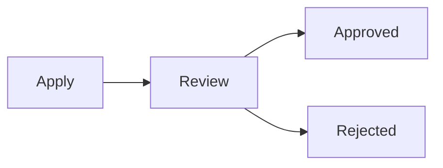

# Workspace File Preview for DeepSeek Harness

Read, render and edit the workspace files you are working on — inside the
DeepSeek Harness web UI, without leaving the conversation.

Open a `.md` file and the right-hand sidebar renders it as GitHub-flavoured
Markdown, with every ` ```mermaid ` block drawn as a real diagram. Open an
`.html`, `.svg` or an image and you can point at the part that needs work and
hand it to the agent as an annotation. Open a video and it plays in the same
panel. There is also a workspace file tree with search and pinning, and an
in-place Markdown editor that writes back to the file on disk.

```
┌ conversation ────────────────┬ document ───────────────────────────┐
│ agent / user turn            │  Markdown (Mermaid)                 │
│                              │  ────────────────────────────────  │
│                              │  # Release notes                   │
│                              │  ┌──────────────────────────────┐  │
│                              │  │  ┌────────┐      ┌────────┐  │  │
│                              │  │  │ build  │─────▶│ deploy │  │  │
│                              │  │  └────────┘      └────────┘  │  │
│                              │  └──────────────────────────────┘  │
└──────────────────────────────┴───────────────────────────────────┘
```

## What you get

| | |
| --- | --- |
| **Markdown rendering** | GFM tables, task lists, footnotes, front matter, code blocks with copy / wrap toggles |
| **Mermaid diagrams** | drawn as figures in an editorial skin — paper card, hairline rules, one accent — with fit / zoom, drag-to-pan and a full-screen view |
| **In-place editing** | edit the Markdown source in the sidebar and save it back to the file |
| **AI annotation** | pick an element in an HTML/SVG page, or drag a box over an image, and send the selection to the agent |
| **Video playback** | MP4, MOV, WebM, M4V, OGV, AVI and MKV play in the panel, with size, duration and resolution under the player |
| **File tree** | browse the workspace, search it, pin what matters, rename / move / delete from a context menu |
| **Straight to the agent** | "add to chat", "let the agent edit this", or comment on a selection — the file reference lands in the composer |

## Diagrams drawn as figures

A ```mermaid` block is not a widget in a dashboard: it sits in a document,
next to prose, and it has to read like a figure. The renderer therefore does
not use Mermaid's default business theme. It draws on a paper card with a
hairline border and a dot grid, sets node labels and zone titles on a small
type scale, uses mono micro type for arrow labels and ER field types, and
reserves a single warm accent for the one or two nodes the diagram is about.

**Focal nodes.** By default the accent goes to the flow's hub — a node of
degree three or more, or both of them when exactly two tie. Name them yourself
when that is wrong:



`%% focal: A, C` pins the accent, `%% focal: none` removes it. The directive
is a comment, so the source stays valid Mermaid anywhere else.

**Reading a wide diagram.** A diagram that does not fit is not shrunk into
illegibility: the figure keeps a minimum type size and scrolls, drag pans it,
and the expand button opens it full screen (`Esc` closes). Zoom, the fit
button and full screen are on the small toolbar in the top-right corner.

**Dark mode and fonts.** The figure follows the host theme and redraws when it
changes. No web font is fetched — the stacks ask for the editorial faces first
and fall back to the platform's own, so the preview keeps working offline and
makes no network request to draw a diagram.

The skin is ported from the MIT-licensed
[diagram-design](https://github.com/cathrynlavery/diagram-design) skill:
colours, type scale, geometry and the one-accent rule. Nothing else from that
project is redistributed — no fonts, icons or templates. See
[ATTRIBUTION.md](plugin/ATTRIBUTION.md) for the licence, the pinned revision,
and the exact reuse scope.

## Install

```bash
git clone https://github.com/colsonSung/dsh-workspace-file-preview.git
cd dsh-workspace-file-preview
./install.sh              # installs into the profile of the running Harness
```

`install.sh` takes an optional profile name (`./install.sh web`) and is
idempotent. It installs the package into the profile and adds the bundle row
to `<profile>/cordis.patch.yml`. **Restart the Harness afterwards** — the
host half of a plugin is loaded at start-up.

Manual equivalent:

```bash
dsh plugin --profile web add ./plugin
```

```yaml
# <profile>/cordis.patch.yml
- insert:
    - id: workspace-file-preview
      name: 'dsh-workspace-file-preview'
```

Requirements: the DeepSeek Harness CLI (`dsh`) on your `PATH`, and Node.js 22
only if you want to rebuild the client bundles from source.

### Uninstall

```bash
dsh plugin --profile web remove dsh-workspace-file-preview
```

Then delete the bundle row from `<profile>/cordis.patch.yml` and restart the
Harness.

### Upgrading from the old name

This plugin was called **Markdown & Mermaid Preview** until v1.2.0, and
installed as `dsh-markdown-mermaid-preview`. The name changed because the
plugin stopped being only about Markdown: it also annotates HTML and images,
and it plays video.

To move over:

```bash
dsh plugin --profile web remove dsh-markdown-mermaid-preview
```

Then remove the old bundle row from `<profile>/cordis.patch.yml`, install this
version as above, and restart the Harness. Your pinned-file list is carried
over — the plugin reads the old `mmd-pinned::<workspace>` key once and then
drops it.

## How it works

The plugin has two halves, exactly like every DeepSeek Harness plugin.

**Host half** — `plugin/index.js`, plain Node, runs inside the Harness
process. It registers four commands on the session:

| Command | What it does |
| --- | --- |
| `/wfp-save` | write edited content back to a workspace file |
| `/wfp-fs` | file operations for the file-tree context menu: `mkdir`, `create`, `rename`/`move`, `copy`, `delete` |
| `/rename` | rename the current session |
| `/retitle` | regenerate the session title from the whole conversation |

**Client half** — `plugin/src/client-entry.js`, a browser bundle that the
Harness web shell loads. It registers three document-preview tabs in the
right-hand sidebar (`Markdown (Mermaid)`, `HTML (AI Annotate)`,
`Image (AI Annotate)`, `Video`), the *Edit* and *Locate* document actions, and the
*Files* tab (workspace tree, search, pinning, context menu). The web side
calls the host commands above through the Harness remote-command API — it
never touches the filesystem directly from the browser.

Two renderer chunks are fetched on demand by the Harness client module
system, so they cost nothing until you use them:

| File | Contents | Loaded when |
| --- | --- | --- |
| `plugin/client.editor.js` | `marked` (Markdown → HTML) and `turndown` (HTML → Markdown) | you open the Markdown editor |
| `plugin/client.mermaid.js` | `mermaid` | a document contains a diagram |

The diagram figure itself lives in two small modules that are part of
`plugin/client.js`: `src/mermaid-skin.js` is the single source of truth for the
token table, the type scale and the Mermaid theme, and `src/mermaid-svg.js` is
the post-render pass that removes Mermaid's shadows, rounds corners, writes
the zone eyebrows and applies the accent.

### Built bundles are committed

`plugin/client.js`, `plugin/client.editor.js` and `plugin/client.mermaid.js`
are **committed to this repository**. The Harness plugin installer does not
run a build step, so a fresh clone has to work as-is — and it does: clone,
run `./install.sh`, restart, done. No `npm install` required.

If you change anything under `plugin/src`, rebuild the bundles:

```bash
cd plugin
npm install          # esbuild + the renderer libraries
npm run build        # writes client.js, client.editor.js, client.mermaid.js

# The published package name is part of the client: the module id and every
# document-preview id are built from it. A local link install uses the @local
# scope, so a release build names the published package explicitly.
WFP_PACKAGE_NAME=dsh-workspace-file-preview npm run build
```

The build uses `esbuild` with `legalComments: 'eof'`, so the `/*! ... */`
license banners of the bundled third-party code are kept at the end of each
bundle.

A rebuild is *not* guaranteed to be byte-identical to the committed bundle:
npm and pnpm lay out nested dependencies differently, so a few transitive
packages inside `client.mermaid.js` can resolve to a different copy. The
committed bundles are the ones that shipped in the `v1.3.0` release — rebuild
and commit the result if you change `plugin/src`.

## Security and privacy

The plugin holds **no credentials**, asks for **no API keys**, and makes **no
network requests of its own** — Markdown, Mermaid and the annotation UI all
run locally in your browser.

* **File access.** File reads and writes go through the Harness file API. The
  host half refuses relative paths, any path containing `..`, non-regular
  files, and writes larger than 4 MB. The file-tree operations (create,
  rename, move, copy, delete) run with the privileges of the Harness process
  itself, so install this plugin only if you trust the code that drives your
  UI.
* **What is written to disk.** Only one file: the bundle row in
  `<profile>/cordis.patch.yml`. Nothing else, and no secrets.
* **What is stored in the browser.** Your pinned-files list, in `localStorage`
  under `wfp-pinned::<workspace>`. Clearing the site data removes it. A list
  written under the plugin's previous name (`mmd-pinned::<workspace>`) is read
  once and then dropped, so renaming the plugin does not empty your pins.
* **Third-party code.** The bundles inline MIT-licensed libraries (mermaid,
  marked, turndown and mermaid's own dependency tree). They are ordinary
  browser libraries with no telemetry.

See [SECURITY.md](SECURITY.md) for the reporting process.

## Third-party licenses

This plugin's own code is MIT licensed (see [LICENSE](LICENSE)).

The published bundles inline the following third-party packages, all under
the MIT license:

| Package | Version | Copyright | Where |
| --- | --- | --- | --- |
| [mermaid](https://github.com/mermaid-js/mermaid) | 12.2.0 | Copyright (c) 2014 - 2022 Knut Sveidqvist | `plugin/client.mermaid.js` |
| [marked](https://github.com/markedjs/marked) | 18.1.1 | Copyright (c) 2019+, MarkedJS | `plugin/client.editor.js` |
| [turndown](https://github.com/mixmark-io/turndown) | 7.2.4 | Copyright (c) 2017 Dom Christie | `plugin/client.editor.js` |
| [turndown-plugin-gfm](https://github.com/mixmark-io/turndown-plugin-gfm) | 1.0.2 | Copyright (c) 2017 Dom Christie | `plugin/client.editor.js` |
| [esbuild](https://github.com/evanw/esbuild) | 0.28.2 | Copyright (c) 2020 Evan Wallace | build tool only, not shipped |

`plugin/client.mermaid.js` additionally contains mermaid's own dependency
tree (d3, cytoscape, lodash-es, dompurify, dayjs and others) under their
respective MIT / ISC licenses. The build keeps the `/*! ... */` legal comments
of those packages at the end of the bundle, but it does **not** inline every
license text — in particular mermaid's own MIT notice is not inside the
bundle, so it is reproduced here:

```
The MIT License (MIT)

Copyright (c) 2014 - 2022 Knut Sveidqvist

Permission is hereby granted, free of charge, to any person obtaining a copy
of this software and associated documentation files (the "Software"), to deal
in the Software without restriction, including without limitation the rights
to use, copy, modify, merge, publish, distribute, sublicense, and/or sell
copies of the Software, and to permit persons to whom the Software is
furnished to do so, subject to the following conditions:

The above copyright notice and this permission notice shall be included in all
copies or substantial portions of the Software.

THE SOFTWARE IS PROVIDED "AS IS", WITHOUT WARRANTY OF ANY KIND, EXPRESS OR
IMPLIED, INCLUDING BUT NOT LIMITED TO THE WARRANTIES OF MERCHANTABILITY,
FITNESS FOR A PARTICULAR PURPOSE AND NONINFRINGEMENT. IN NO EVENT SHALL THE
AUTHORS OR COPYRIGHT HOLDERS BE LIABLE FOR ANY CLAIM, DAMAGES OR OTHER
LIABILITY, WHETHER IN AN ACTION OF CONTRACT, TORT OR OTHERWISE, ARISING FROM,
OUT OF OR IN CONNECTION WITH THE SOFTWARE OR THE USE OR OTHER DEALINGS IN THE
SOFTWARE.
```

### Diagram skin (design values, not code)

`plugin/src/mermaid-skin.js` and `plugin/src/mermaid-svg.js` port the
diagram-design skin — colour tokens, the type scale, geometry conventions and
the one-accent rule — from
[diagram-design](https://github.com/cathrynlavery/diagram-design)
(MIT, Copyright (c) 2025 Cathryn Lavery), pinned at revision
`6a7f19fcc132b39b126bea90167679b46b14bcc4`.

No code, font, icon, asset or HTML template from that project is
redistributed, and no product mark is used. The upstream MIT notice is
reproduced in full, together with the exact reuse scope and the upstream
third-party notices that constrain *it* rather than this package, in
[`plugin/ATTRIBUTION.md`](plugin/ATTRIBUTION.md).

## License

MIT — see [LICENSE](LICENSE).
